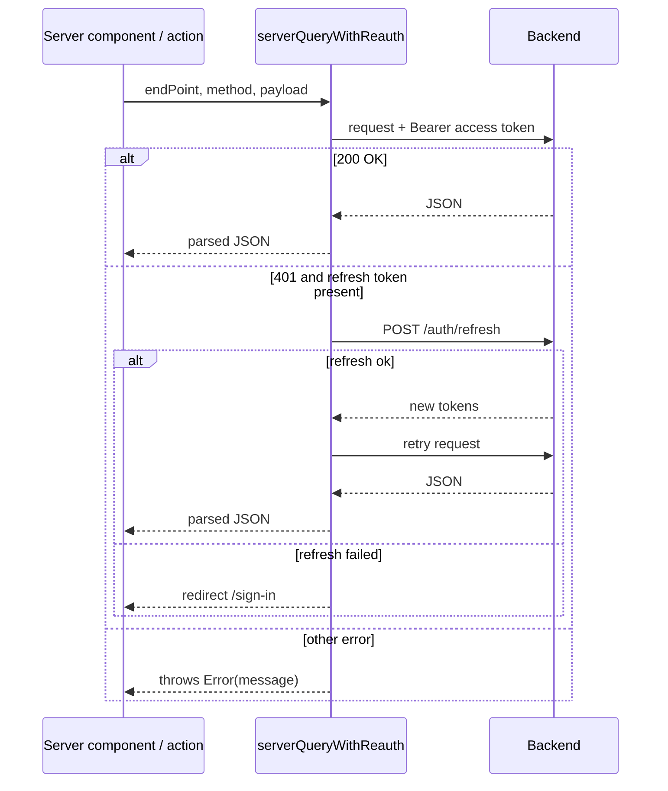

# Architecture

Fashi-ON is a fashion marketplace. This repository is the **frontend only**: a Next.js 15 App Router app that talks to a separate backend (Node/Express/Prisma) over REST and Socket.IO. For day-to-day commands see `CLAUDE.md` and `README.md`; this document explains how the pieces fit together.

| Area | Technology |
|---|---|
| Framework | Next.js 15 (App Router), React 19, TypeScript |
| Styling / UI | Tailwind CSS v4 (configured in `src/app/globals.css`), shadcn/ui ("new-york") |
| Client state & API | Redux Toolkit, RTK Query, redux-persist |
| Forms | react-hook-form + zod |
| Real-time | socket.io-client |
| Notifications | sonner |

Path alias: `@/*` → `src/*`.

## Directory map

```
src/
  app/                 Routes (App Router), grouped by route group
    (auth)/            sign-in, sign-up/[role], verify-otp, forget/set password, auth-finish
    (public)/          shop, product pages, member/[username], checkout, blogs, help, ...
    (profile)/profile/ logged-in dashboard: sell, purchase, earnings, donation, assisted-sell, ...
    (private)/         inbox, assisted-seller
  components/
    ui/                shadcn primitives (generated; extend rather than rewrite)
    shared/            cross-page components (Navbar, Footer, Cards, Modal, ...)
    modules/           larger feature blocks (currently home)
    skeletons/         loading placeholders
  lib/
    services/          server-side GET helpers (used from server components)
    Actions/           "use server" mutations + the shared server fetch wrapper
    provider/          Providers.tsx (Redux, persistence, tooltips)
    *Data.ts           static option lists (brands, colors, sizes, conditions, ...)
    authRoutes.ts, profileRoutes.ts, userRole.ts
  redux/
    api/               RTK Query endpoints (injected into baseApi)
    features/          slices: auth, cart, rate
    store.ts, tagTypes.ts, hooks.ts
  Context/             SocketProvider
  hooks/               useCurrency, useUpdateSearchParams, ...
  utils/               serverTags, formatters, role helpers
  config/index.ts      EnvConfig (single place that reads env vars)
  middleware.ts        auth redirect
```

Page-specific components live next to their page in `_components/` (a few older folders use `components/`). Components used by more than one page go in `src/components/shared`.

## Routing and access control

`src/middleware.ts` only runs for the paths in its `matcher`: `/profile/*`, `/sell/*`, `/favourites`, `/notifications`, `/inbox`, `/checkout/*`, `/shopping-cart`, `/assisted-seller`. If the `fashion-access-token` cookie is missing it redirects to `/sign-in?callbackUrl=<original path>`. `src/lib/authRoutes.ts` lists the auth pages that are exempt from that redirect.

To protect a new route, add it to the `matcher`. Middleware only checks that a token cookie exists; it does not validate it or check roles.

## Data layer

There are two parallel ways to talk to the backend. Which one a page uses depends on whether the call happens on the server or in the browser.

### 1. Server path: services and server actions

- `src/lib/services/*` export read functions called from server components.
- `src/lib/Actions/*.action.ts` are `"use server"` mutations called from client components.
- Both go through `serverQueryWithReauth` (`src/lib/Actions/ReAuthRequest.ts`), which:
  1. reads `fashion-access-token` and `fashion-refresh-token` from the request cookies,
  2. calls `EnvConfig.serverBaseUrl + endPoint` with a `Bearer` header,
  3. on a 401 with a refresh token, calls `/auth/refresh` and retries once,
  4. redirects to `/sign-in` if refresh fails or there are no tokens,
  5. **throws** an `Error` (with the backend message) for any other non-OK response.
- Caching is controlled per call with Next fetch options (`cache`, `revalidate`, `tags`). Tag names are centralised in `src/utils/serverTags.ts`. After a mutation, actions call `revalidateTag` / `revalidatePath`.
- Server actions return `{ success, message, data }` rather than throwing, and **must rethrow** when `isRedirectError(error)` is true; otherwise the sign-in redirect is swallowed.



### 2. Client path: RTK Query

- `src/redux/api/baseApi.ts` creates the single `createApi` instance. Feature files (`productApi.ts`, `order.api.ts`, `message.api.ts`, ...) add endpoints with `baseApi.injectEndpoints`.
- Cache tags must be registered in `src/redux/tagTypes.ts` (both the `tagTypes` object and `tagTypesList`).
- The base query uses `EnvConfig.baseUrl` and sets `Authorization: Bearer <state.auth.token>`. During auth flows (sign-up, OTP, password reset) it also sends a `token` header read from sessionStorage (`signUpToken`, `verifyOtpToken`, `forgotPasswordToken`, `resetPasswordToken`, `token`).
- On a 401 it posts to `/auth/refresh`, dispatches `setUser` with the new tokens and retries; if that fails it dispatches `logout`.

### Choosing between them

Follow the surrounding code: server-rendered listings and detail pages (products, orders, cart, donations) use `services/*`; interactive or polling features (chat, notifications, dashboards, forms using hooks) use RTK Query. Both paths use the same backend and the same refresh endpoint, but they keep separate caches (Next data cache vs the Redux store), so a mutation in one does not refresh the other automatically.

## Authentication and roles

Tokens are stored in two places that must be kept consistent:

- **Cookies** (`fashion-access-token`, 7 days; `fashion-refresh-token`, 30 days), set by `setAuthCookie` in `src/lib/Actions/Auth.action.ts`. Used by middleware and server-side fetches. They are not `httpOnly`.
- **Redux `auth` slice** (persisted to localStorage): `{ user, token }`. Used by RTK Query and the socket connection. `logout` clears the user, the token and both cookies.

Roles are defined in `src/lib/userRole.ts` (`INDIVIDUAL_USER`, `CHARITABLE_ORGANIZATION`, `CHARITY_SHOP`, `ECO_FRIENDLY_STORE`, `CELEBRITY`, `AMBASSADOR`, `PROFESSIONAL_SELLER`, `ASSISTED_SELLER`). The profile navigation in `src/lib/profileRoutes.ts` filters entries by an optional `roles` array (omitted = all roles), using reusable groups such as `SELLER_ROLES`. Sign-up is role-specific (`/sign-up/[role]`).

## Global providers and real-time

`src/app/layout.tsx` is a server component. It fetches exchange rates (`GetRates`) and renders:

```
Providers (Redux Provider -> PersistGate -> TooltipProvider)
  SetRates            pushes server-fetched rates into the rate slice
  Navbar
  SocketProvider      wraps {children}
  Footer
  NextTopLoader
  Toaster (sonner)
```

`SocketProvider` (`src/Context/SocketProvider.tsx`) opens a websocket to `NEXT_PUBLIC_SOCKET` only when `auth.token` exists, passing the token in `auth`. Components access it through `useSocket()`. The inbox, messages and notifications build on it.

## Client state (Redux)

| Slice | Purpose | Persisted |
|---|---|---|
| `auth` | current user + access token | yes (`auth` key) |
| `rate` | exchange rates and the user's chosen currency/country | yes (`rate` key) |
| `cart` | per-cart-group checkout extras (selected shipment, tree count/cost, authentication flag) | no |

Server-side cart contents are not in Redux; they come from the backend via `services/Cartprods.ts` and `Actions/Cart.action.ts`.

## Currency

All prices from and to the API are in **GBP** (the base currency). The root layout loads rates server-side (`GetRates`, `base=GBP`, so each rate is GBP to quote) and `SetRates` stores them in the `rate` slice. `useCurrency()` (`src/hooks/useCurrency.ts`) exposes `convert`, `format`, `formatWithCode`, `symbol`, `code`, `isGbp`, `isDefault` and `country` based on the user's selection (GBP, EUR or USD; default GBP). `rate.user.isDefault` is `true` while the currency is the default or auto-detected and `false` once the user picks one in the footer modal. `FormatCurrency` (`src/components/shared/FormatCurrency.tsx`) is the component wrapper. Avoid formatting raw amounts by hand and never hardcode `$`.

Conversion is for browsing prices only (product cards, details, cart, wishlist). Records that must not change with the preference (orders, purchases, returns, checkout totals, dashboards, earnings, transactions, donations, offers) are always GBP: use `<FormatCurrency fixed />` or `formatGbp` from `useCurrency`.

Browsing prices use `<FormatCurrency withGbp />` (or `ProductPrice` on product cards): the preferred-currency amount with `≈` and a small exact GBP line. Checkout uses `<FormatCurrency fixed estimate />` per line and `CheckoutTotal` for the total, the "Pay £x" button and the GBP charge notice. `GbpChargeNote` shows "Charged in GBP…" when the currency is not GBP. The backend has no currency field on products or donations; every stored amount is GBP.

Any input whose value is sent to the API as money must use `GbpInput` (`src/components/shared/GbpInput.tsx`): it shows `£` and `GBP`, and renders `ConvertedEstimate` (`≈ $12.70 USD (estimate)`) under the field when the preferred currency is not GBP.

## UI layer

- shadcn components live in `src/components/ui`; `components.json` holds the generator config.
- Tailwind v4 is configured through CSS (`globals.css`), not a `tailwind.config` file.
- Select/filter option lists are constants in `src/lib/*Data.ts`; brands, categories, materials and sizes also have RTK Query endpoints for server-driven values.

## Configuration and deployment

`src/config/index.ts` (`EnvConfig`) is the only place env vars should be read:

| Variable | Used for |
|---|---|
| `NEXT_PUBLIC_BASE_URL` | API base for client-side RTK Query |
| `SERVER_BASE_API` | API base for server-side fetches |
| `NEXT_PUBLIC_SOCKET` | Socket.IO server |
| `NEXT_PUBLIC_CLIENT_BASE_URL`, `SERVER_ROOT` | app/root URLs |
| `NEXT_PUBLIC_MAP_KEY` | Google Maps |
| `HAS_SSL` | `secure` flag on auth cookies |
| `RATES_API_BASE_URL` | exchange-rate API |

`pnpm dev` serves on port 5001. The Dockerfile builds with pnpm on Node 22 and runs `pnpm start`; `docker-compose.yml` maps port 3000. `next.config.ts` allows remote images from any host and raises the server action body limit to 500 MB (image uploads through `FormData`).

## Known quirks

- `ReAuthRequest.ts` refreshes tokens in server code and writes them with `js-cookie` (a browser library); the equivalent `cookies().set` code is commented out. Verify token-refresh behaviour on the server path before relying on it.
- `authSlice.setUser` has its cookie-writing code commented out, so cookies are only set by `setAuthCookie`.
- `src/lib/Actions/Product.api.ts` is named like an RTK file but contains server action code.
- Older pages use `components/` instead of `_components/`.
